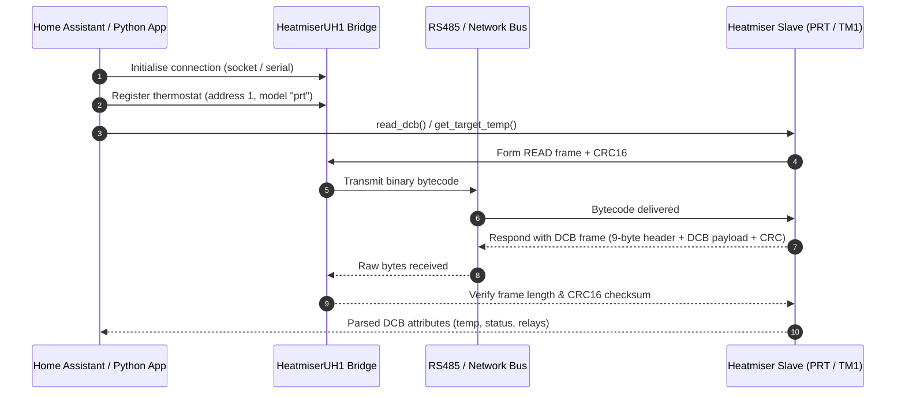

# heatmiserv3

[](https://github.com/andylockran/heatmiserv3/actions/workflows/python-package.yml)
[](https://andylockran.github.io/heatmiserv3/)
[](https://github.com/andylockran/heatmiserv3)
[](https://docs.astral.sh/uv/)
[](LICENSE.TXT)
[](https://flake8.pycqa.org/)

> [!CAUTION]
> Having lost access to physical Heatmiser hardware a few years ago, the maintainer can no longer perform real-world hardware regression testing.
>
> If you are interested in taking over maintenance or migrating the repository to a dedicated community organization, please reach out or open an issue! For architectural decisions made since losing hardware access, see the [ADRs in docs/adrs/](docs/adrs/README.md).

---

📖 **[View the Complete Protocol & Library Documentation Website](https://andylockran.github.io/heatmiserv3/)**

The documentation includes an interactive **Visual Test Harness (Digital Twin)** simulating backlit LCDs, relay contact states, underfloor overheat cutouts, environment sliders, and live RS485 bytecode packet inspection.

---

## Overview

`heatmiserv3` is a Python library to interact with Heatmiser Thermostats and Timing Switches communicating over the Heatmiser V3 RS485 serial-over-IP or serial bus protocol.

It provides high-level object models (`HeatmiserThermostat`, `TM1Thermostat`) as well as network connection multiplexing (`HeatmiserUH1`) to read Data Control Blocks (DCBs), inspect telemetry, adjust setpoints, and configure heating/timing schedules.



## Supported Hardware

| Category | Models | Protocol Features |
| :--- | :--- | :--- |
| **Thermostats** | `PRT`, `PRT-E`, `PRT-HW`, `DT`, `DT-E` | Full DCB read, setpoint modification, frost protection, floor temperature limit monitoring |
| **Timing Switches** | `TM1`, `TM1-N` | Relay switching, holiday hours, countdown timer, 5/2 & 7-day switching schedules |
| **Wiring Centres** | `UH1` | RS485 serial-over-IP multiplexing for up to 32 chained thermostats |

## Installation

Using `pip`:
```bash
pip install heatmiserv3
```

Using `uv`:
```bash
uv add heatmiserv3
```

## Quick Start

### Interfacing with a PRT Thermostat via UH1

```python
from heatmiserv3 import connection, heatmiser

# 1. Connect to Heatmiser UH1 wiring centre over TCP/IP
uh1 = connection.HeatmiserUH1("192.168.1.57", 8068)

# 2. Register a thermostat attached to the UH1 bus at RS485 address 1
thermo1 = heatmiser.HeatmiserThermostat(1, "prt", uh1)

# 3. Read telemetry
print(f"Room Temperature: {thermo1.get_floor_temp()}°{thermo1.get_temperature_format()}")
print(f"Target Temperature: {thermo1.get_target_temp()}°C")
print(f"Heating Active: {thermo1.get_heating() == 1}")

# 4. Modify setpoints (with built-in range validation)
success = thermo1.set_target_temp(21)
if success:
    print("Target temperature updated to 21°C")
```

### Interfacing with a TM1 Timing Switch

```python
from heatmiserv3 import connection, heatmiser

uh1 = connection.HeatmiserUH1("192.168.1.57", 8068)
timer = heatmiser.TM1Thermostat(2, uh1)

# Check timer status
print(f"On/Off: {timer.get_on_off()}")
print(f"Program Mode: {timer.get_program_mode()}")

# Override timer ON
timer.set_timer_state(1)
```

## Architecture Decision Records (ADRs)

Key architectural decisions are documented under [`docs/adrs/`](docs/adrs/README.md):

- [ADR 0001: Record architecture decisions](docs/adrs/0001-record-architecture-decisions.md)
- [ADR 0002: Logic-led development](docs/adrs/0002-logic-led-development.md)
- [ADR 0003: Modernize tooling, resilience, and test coverage](docs/adrs/0003-modernize-tooling-resilience-and-coverage.md)

## Development & Testing

This project uses [uv](https://docs.astral.sh/uv/) and [hatchling](https://hatch.pypa.io/).

```bash
# Clone the repository
git clone https://github.com/andylockran/heatmiserv3.git
cd heatmiserv3

# Install dependencies into virtualenv
uv sync

# Run tests and verify >90% coverage gate
uv run pytest --cov=heatmiserv3 --cov-report=term-missing

# Run code style and lint checks
uv run flake8

# Build source distribution and binary wheel
uv build
```

See [CONTRIBUTING.md](CONTRIBUTING.md) for contribution guidelines.

## Origin & Credits

This library originated from reverse engineering and protocol implementation work carried out by **Neil Trimboy in 2011** on [Google Code](https://code.google.com/archive/p/heatmiser-monitor-control/). It has been maintained and modernized by **Andy Loughran** and community contributors.
